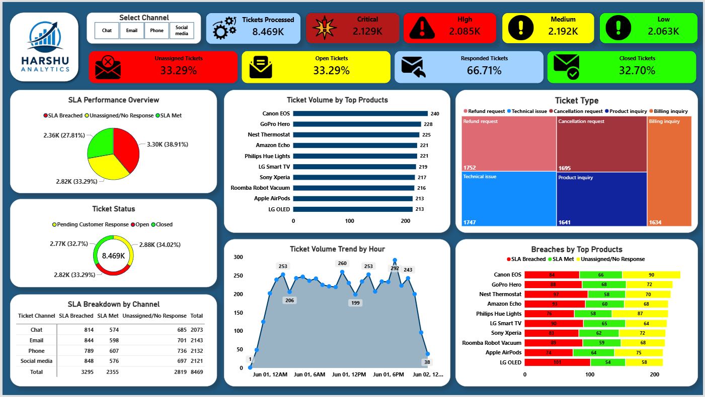

# ⏱️ SLA Performance & Workflow Tracker (Power BI & DAX)

### 📌 Project Overview
Architected an operational performance interface in Power BI to monitor real-time customer support SLA queues, response times, resolution statuses, and Customer Satisfaction (CSAT) ratings[cite: 18, 19]—inspired by managing 4-hour SLA tagging queues for a 25-member operations team[cite: 19].

---

### 🖼️ Dashboard Preview

---

### ⚙️ Technical Architecture & Workflow
* **Power Query (ETL) & Feature Engineering:** Imported and cleaned raw support ticket logs (`Customer_Support_Tickets`), standardizing `Date of Purchase` and `First Response Time` timestamps and creating custom grouping bins (`First Response Time (bins)`).
* **Explicit DAX Measures:** Authored DAX calculations to compute SLA Compliance %, Ticket Volume, Resolution Rate, and Average Customer Satisfaction Rating[cite: 18, 19].
* **Visual Alert Logic:** Configured gauge indicators, conditional color formatting for SLA breach alerts, and dynamic card layouts for shift leads[cite: 19].

---

### 📂 Repository Files
* `SLA_Performance_Tracker.pbix` – Full Power BI Desktop report[cite: 19]
* `dashboard_overview.png` – High-resolution dashboard UI snapshot
* `Customer_Support_Tickets.csv` – Source operational ticket dataset[cite: 18]
